# PfeilZaehler3000

Automatic arrow counter for recurve, barebow and compound bows.

A small sensor pod screws into a 5/16"-24 UNF stabilizer bushing of the riser (e.g. the front
bushing of a Kinetic Sovren) and detects every shot from the vibration of the bow. For every arrow it
also measures the shot phases (raise, draw, hold), how much the bow moved while aiming, the bow
angle and cant at the release and the follow-through. A web page on the phone reads the pod over
Bluetooth and shows arrows per end, session, day, week and month, and the details of every arrow.
An optional Garmin watch app shows the current end and vibrates on every arrow.

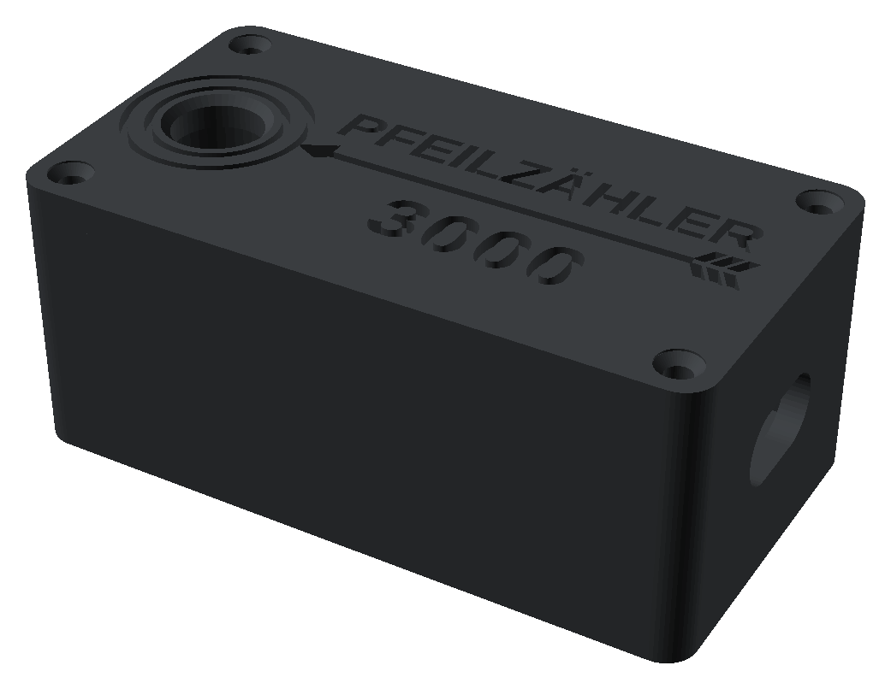

## Features

- Detects shots from the riser's motion: aiming stillness (gyroscope), release jolt and ringing
  (±200 g accelerometer). Shots of other archers are not counted.
- Shot details from the gyroscope and accelerometer: raise, draw & set and hold times, aim
  movement in the last second (degrees and cm at the target), bow angle, cant and follow-through.
- Stores about 1,400 arrows with details in the pod; works without a phone during training.
- Phone page (single HTML file, Web Bluetooth): live count, ends, sessions with averages, totals,
  charts, arrow details, deleting single arrows or ends, CSV export, backup and restore.
- Garmin watch app (Epix Gen 2): time of day, current end, session, today/week/month, time to
  sunset, vibration per arrow, new end and undo buttons, settings menu, Garmin activities with one
  lap per end.
- Today/week/month counters and the settings (arrows per end, end pause) are kept in the pod, so
  phone and watch show the same numbers.
- Power saving after 3 minutes without movement; Bluetooth stays available.

## Building one

Everything is described in the build guide:
[docs/BUILD.md](docs/BUILD.md) · [PDF](docs/PfeilZaehler3000-Build-Guide.pdf)

Main parts: Seeed XIAO nRF52840 Sense, Adafruit ADXL375 breakout, 300 mAh LiPo (402535),
5/16"-24 UNF × 5/8" socket head cap screw, M2 heat-set inserts and screws, PETG-CF and PETG
filament. Approx. € 55–70 in parts.

## Phone page

**Open the phone page: https://ckpt-gthb.github.io/pfeilzaehler3000/app/**

**Try it without a pod:** https://ckpt-gthb.github.io/pfeilzaehler3000/app/?demo shows the page with
example data and a simulated pod. Nothing is saved.

The page only contains the program. It runs in the phone's browser: each phone connects to its
own pod over Bluetooth and keeps its history locally. Nothing is sent to this repository or to
anyone else, so everyone can use this address without seeing other people's data.
Use Chrome or Edge (Android, desktop) or the Bluefy browser on iPhone.

  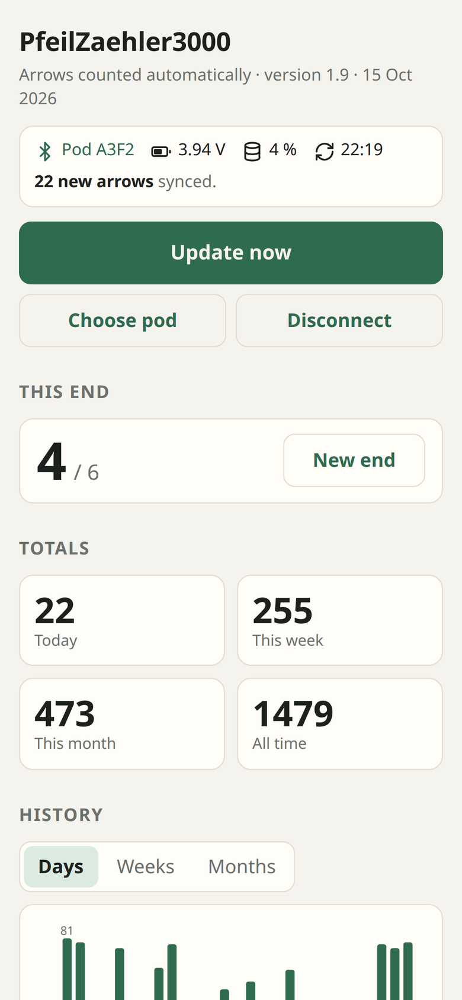
  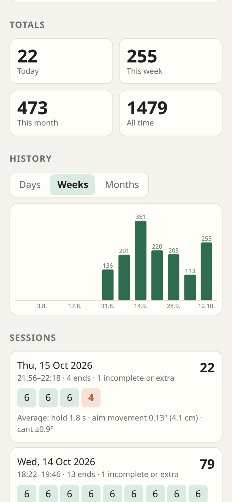
  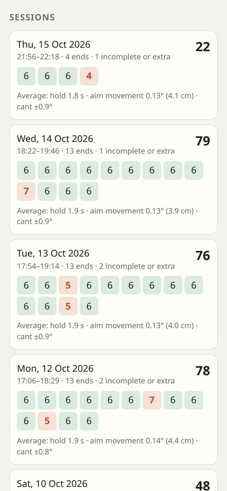

  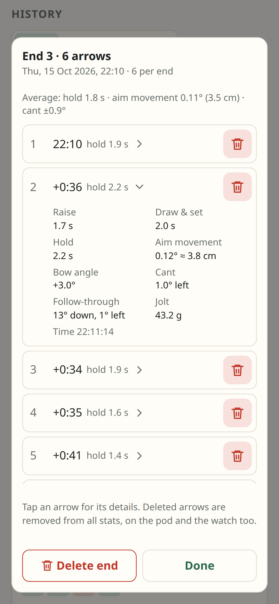
  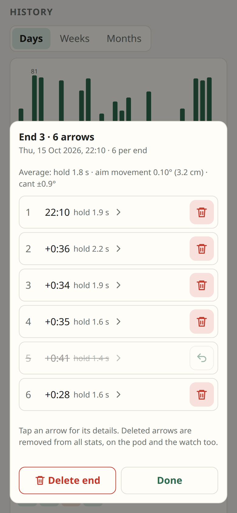
  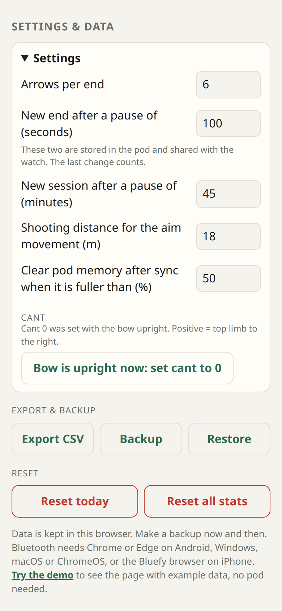

*Status, current end and totals · arrows per week · sessions with averages · the arrows of one end
with split times and one arrow's details · a deleted arrow (restore with the arrow symbol) ·
settings (example data from the demo page)*

To host your own copy, fork this repository and switch on GitHub Pages for the fork
(Settings → Pages → Deploy from branch `main`, folder `/ (root)`); the page is then at
`https://<your-user>.github.io/<repository>/app/`. The history belongs to the web address, so use
Backup / Restore when changing to another address.

Every pod has its own Bluetooth name, `PfeilZaehler3000-XXXX`. Write the 4 characters on your pod
and connect the phone and the watch once with only your pod nearby: both remember it, so several
pods can be used at the same range.

## Garmin watch app

The watch app (Garmin Epix Gen 2) connects to the pod directly. It shows the current end, the time
since the last arrow, arrows this session, today, this week and this month, and vibrates on every
arrow. START records a Garmin activity with one lap per end, DOWN starts a new end, UP deletes the
last arrow, holding UP opens the settings (arrows per end, end pause, which number is shown big,
time to sunset, pod). Build and install: [garmin/README.md](garmin/README.md).

  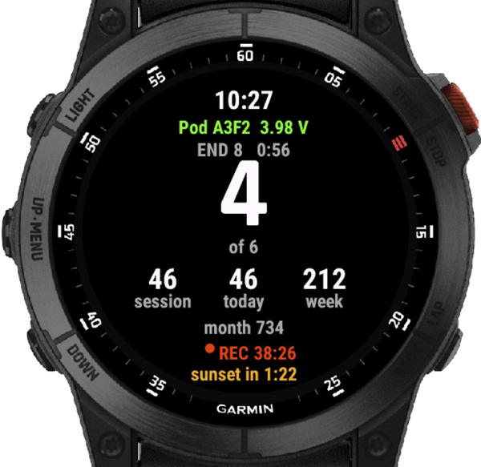
  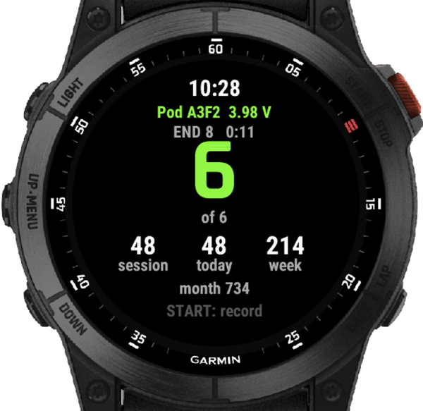
  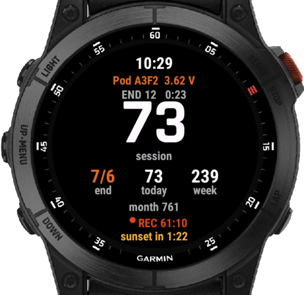

  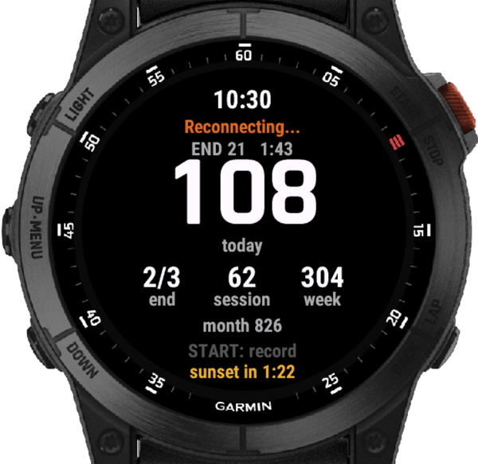
  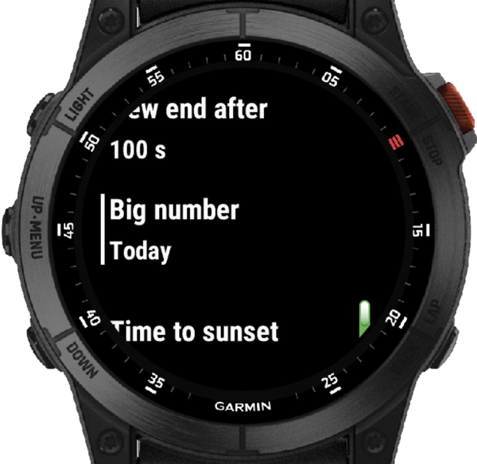
  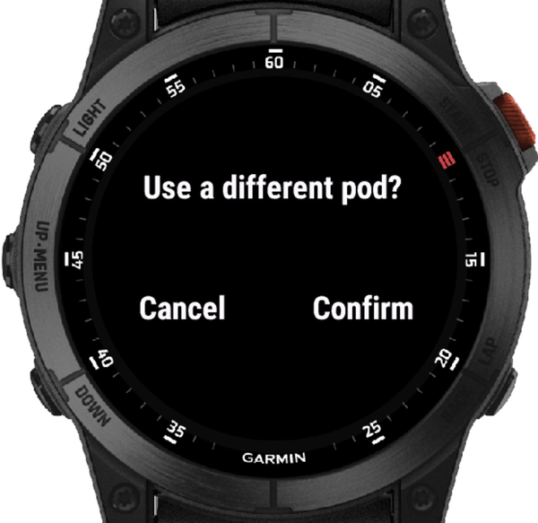

*Recording with time to sunset · end complete · session as the big number with an extra arrow ·
today as the big number while the pod is out of range · settings (hold UP) · changing to a different
pod (simulator, example values)*

## Repository

| Path | Content |
|---|---|
| `firmware/PfeilZaehler3000/` | Pod firmware 1.7 (Arduino, Seeed nRF52 core) |
| `firmware/PfeilZaehler3000Debug/` | Same firmware with diagnostic output, never sleeps |
| `app/index.html` | Phone page 1.9 |
| `garmin/PfeilZaehler3000Watch/` | Garmin Connect IQ watch app 1.3 |
| `housing/` | STL / 3MF print files and the OpenSCAD source `pod.scad` |
| `docs/` | Build guide, Bluetooth protocol, images |

The Bluetooth interface is documented in [docs/PROTOCOL.md](docs/PROTOCOL.md), changes in
[CHANGELOG.md](CHANGELOG.md).

## Licence

- Software (firmware, phone page, watch app): [MIT](LICENSE)
- Housing models, drawings and documentation: [CC BY-SA 4.0](LICENSE-hardware)

World Archery rules do not allow electronic devices on the bow in competition. This is a hobby
project without warranty; handle LiPo cells with care. Kinetic, Garmin, Epix, Seeed, Adafruit and
Bluefy are trademarks of their respective owners; this project is not affiliated with them.
