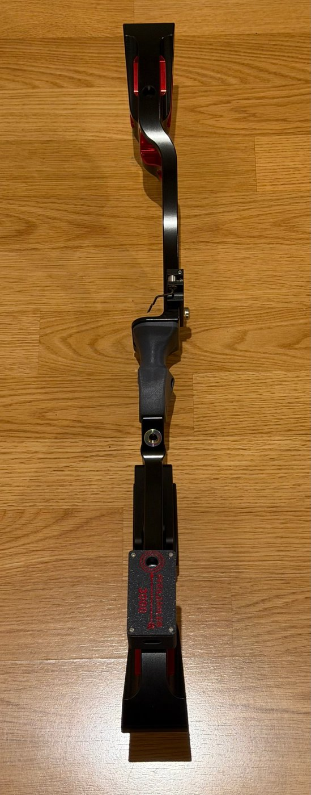
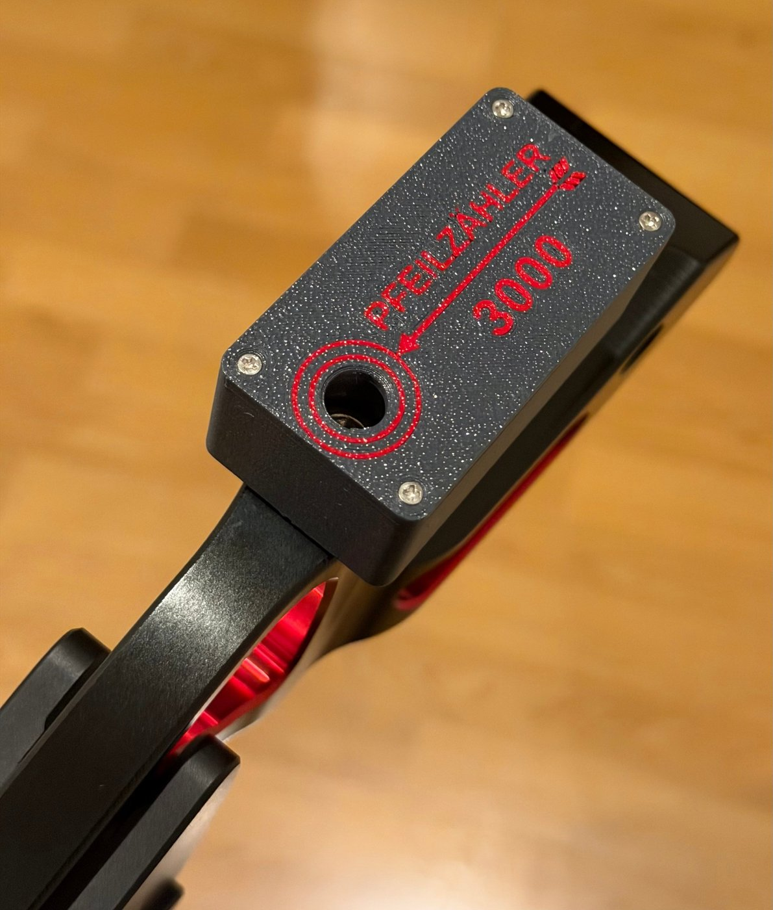
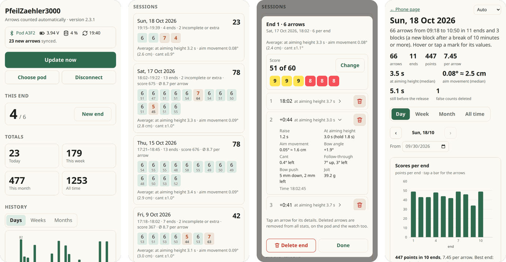
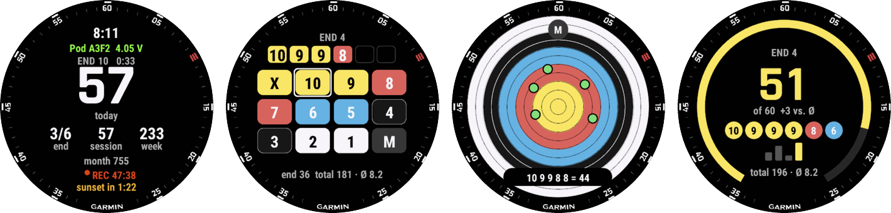

# PfeilZaehler3000

Automatic arrow counter for recurve, barebow and compound bows.

A small sensor pod screws into a 5/16"-24 UNF stabilizer bushing of the riser (e.g. the lowest
bushing on the back of a Kinetic Sovren riser) and detects every shot from the vibration of the
bow. For every arrow it also measures the shot phases (raise, draw, hold), how much the bow moved while aiming, the bow
angle and cant at the release, the follow-through and the bow push. A web page on the phone reads
the pod over Bluetooth and shows arrows per end, session, day, week and month, the details of every
arrow and the scores, with a report page of charts. An optional Garmin watch app shows the current
end, vibrates on every arrow and takes the score of each end.

  
  
  

*The pod · mounted on a Kinetic Sovren 25" riser, on the archer's side in the lowest bushing below
the grip · close-up of the lid with the hole for the hex key*

## Features

- Detects shots from the riser's motion: aiming stillness (gyroscope), release jolt and ringing
  (±200 g accelerometer). Shots of other archers are not counted.
- Shot details from the gyroscope and accelerometer: raise, draw & set and hold times, aim
  movement in the last second (degrees and cm at the target), bow angle and cant (0.1°),
  follow-through and bow push (mm).
- Scores per end on the watch or the phone (numpad, dial or tapping the hit on a target face),
  on a full face or a 3-spot; shared through the pod.
- Report page: charts by day, week, month and all time with short notes, saved as one HTML file
  to pass on.
- Stores about 1,100 arrows with details in the pod; works without a phone during training.
- Phone page (single HTML file, Web Bluetooth): live count, ends, sessions with averages, totals,
  charts, arrow details, end scores, deleting single arrows or ends, CSV export, backup and restore.
- Garmin watch app (Epix Gen 2): time of day, current end, session, today/week/month, time to
  sunset, vibration per arrow, new end and undo buttons, scoring screen that opens after the last
  arrow of an end, settings menu, Garmin activities with one lap and score per end.
- Three mounting points: back of the riser (archer's side), front (target side) or a side bushing.
  A 15-second calibration on the phone finds the mounting point and sets the cant zero.
- Today/week/month counters and the settings (arrows per end, end pause, mounting point, target face) are kept
  in the pod, so phone and watch show the same numbers.
- Phone page and watch app in English, German and Polish, chosen automatically or in the settings.
- Power saving after 3 minutes without movement; Bluetooth stays available.

## Building one

> **What you need, in short** (for archers who have never built electronics):
>
> - **A simple 3D printer.** No multi-colour unit (AMS) needed. Print in **PETG – not PLA**: PLA
>   gets soft in a hot car or in the sun and can crack from the release jolts. The base and the
>   lid are best in PETG-CF (stiffer), which needs a hardened nozzle (about € 10); the clamp
>   frame must be plain PETG. No printer? A friend, a makerspace or a print service can print
>   the three small parts.
> - **Some soldering.** Four short wires from the sensor to the board and the two battery wires,
>   ten joints in all. The pads are small, but it is doable with a fine-tipped soldering iron:
>   about 5 minutes with a set-up workbench, half an hour if the dinner table has to become one
>   first. The eight small metal inserts are pressed into the plastic with the same iron.
> - **Parts, about € 55–70:** about € 55 if you can wait for shipping from China, about € 70 with
>   fast delivery (e.g. Amazon). Seeed XIAO nRF52840 Sense board, Adafruit ADXL375 sensor,
>   300 mAh LiPo battery, a 5/16"-24 bolt, M2 inserts and screws, some wire and about 35 g of
>   filament.
> - **A computer** with the free Arduino IDE to load the software onto the board once (no
>   programming), and a **phone** with Chrome (Android) or Bluefy (iPhone). The Garmin watch app
>   is optional.
>
> If this sounds like too much, ask someone who tinkers – a club mate, a makerspace or a repair
> café. **Under 18?** Build it together with an adult: the soldering iron and the inserts get
> hotter than 200 °C, and LiPo batteries need careful handling (see below).

Everything is described step by step in the build guide:
[docs/BUILD.md](docs/BUILD.md) · [PDF](docs/PfeilZaehler3000-Build-Guide.pdf)

## Phone page

**Open the phone page: https://ckpt-gthb.github.io/pfeilzaehler3000/app/**

**Try it without a pod:** https://ckpt-gthb.github.io/pfeilzaehler3000/app/?demo shows the page with
example data. Nothing is saved.

The page only contains the program. It runs in the phone's browser: each phone connects to its
own pod over Bluetooth and keeps its history locally. Nothing is sent to this repository or to
anyone else, so everyone can use this address without seeing other people's data.
Use Chrome or Edge (Android, desktop) or the Bluefy browser on iPhone.

**Report:** the *Report* button on the phone page opens
https://ckpt-gthb.github.io/pfeilzaehler3000/app/report.html with charts of the stored arrows
(also from a backup file).

*Status and current end · sessions with scores · one end with its score and an arrow's details ·
the report page with the scores per end. More in [docs/SCREENSHOTS.md](docs/SCREENSHOTS.md).*

To host your own copy, fork this repository and switch on GitHub Pages for the fork
(Settings → Pages → Deploy from branch `main`, folder `/ (root)`); the page is then at
`https://<your-user>.github.io/<repository>/app/`. The history belongs to the web address, so use
Backup / Restore when changing to another address.

Every pod has its own Bluetooth name, `PfeilZaehler3000-XXXX`. Write the 4 characters on your pod
and connect the phone and the watch once with only your pod nearby: both remember it, so several
pods can be used at the same range.

## Garmin watch app

The watch app (Garmin Epix Gen 2) connects to the pod directly. It shows the current end, the time
since the last arrow, arrows this session, today, this week and this month, and vibrates on every
arrow. After the last arrow of an end the scoring screen opens (also by holding the screen). START
records a Garmin activity with one lap per end, DOWN starts a new end, UP deletes the last arrow,
holding UP opens the settings (arrows per end, end pause, which number is shown big, time to
sunset, scoring, score design, target face, pod). Build and install: [garmin/README.md](garmin/README.md).

*Main screen with today's arrows as the big number · scoring with the numpad · PiMalDaumen (tap where
the arrow hit) · summary after the end. More in [docs/SCREENSHOTS.md](docs/SCREENSHOTS.md).*

## Repository

| Path | Content |
|---|---|
| `firmware/PfeilZaehler3000/` | Pod firmware 2.3.1 (Arduino, Seeed nRF52 core) |
| `firmware/PfeilZaehler3000Debug/` | Same firmware with diagnostic output, never sleeps |
| `app/index.html` | Phone page 2.3.1 |
| `app/report.html` | Report page 2.3 |
| `garmin/PfeilZaehler3000Watch/` | Garmin Connect IQ watch app 2.3.1 |
| `housing/` | STL / 3MF print files (incl. the TPU washer) and the OpenSCAD source `pod.scad` |
| `docs/` | Build guide, Bluetooth protocol, images |

The Bluetooth interface is documented in [docs/PROTOCOL.md](docs/PROTOCOL.md), changes in
[CHANGELOG.md](CHANGELOG.md).

## Safety

- **No electronics in competition.** World Archery and most national federations do not allow
  electronic devices on the bow at tournaments. This is a training tool.
- **Don't burn your house down.** The LiPo battery can catch fire if it is damaged, short-circuited
  or charged wrongly: charge only over USB-C, not unattended or overnight, and stop using a swollen
  cell.

More on mounting, building and your data: [build guide, section 16](docs/BUILD.md#16-safety-data-and-licence).
This is a hobby project without any warranty; you build and use it at your own risk.

## Licence

Free for personal, non-commercial use: build one for yourself, change it for yourself, give
unchanged copies to friends. Selling pods, kits, prints or apps based on it, or using it in a paid
product or service, is not allowed without a commercial licence – ask through
[GitHub](https://github.com/ckpt-gthb).

- Software (pod firmware, phone page, report page, watch app): [PolyForm Strict 1.0.0](LICENSE)
  with additional permissions for personal changes and for sharing unchanged copies
- Housing models, drawings, images and documentation: [CC BY-NC-ND 4.0](LICENSE-hardware)
- Contributions: see [CONTRIBUTING.md](CONTRIBUTING.md)
