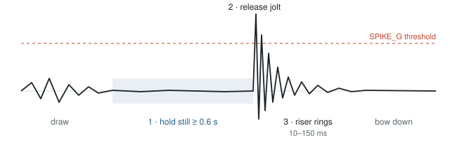
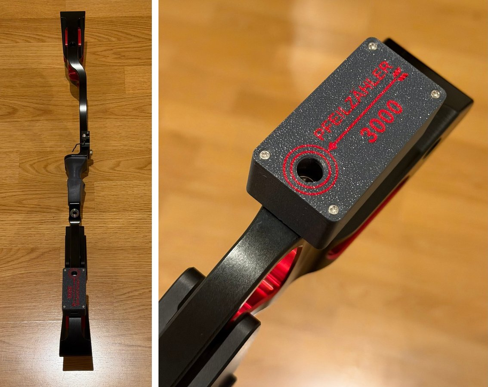
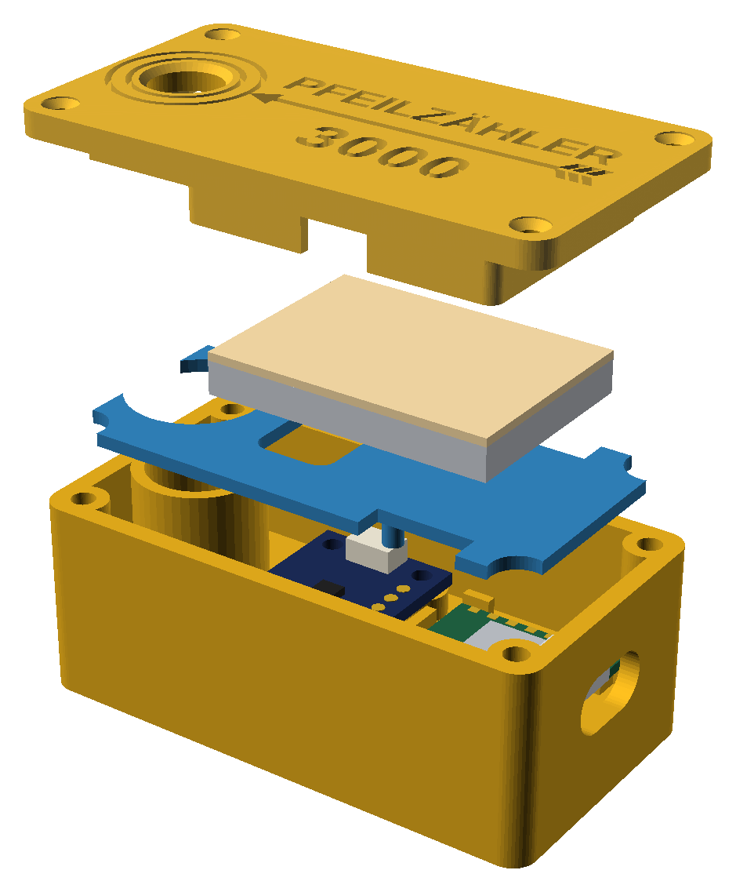
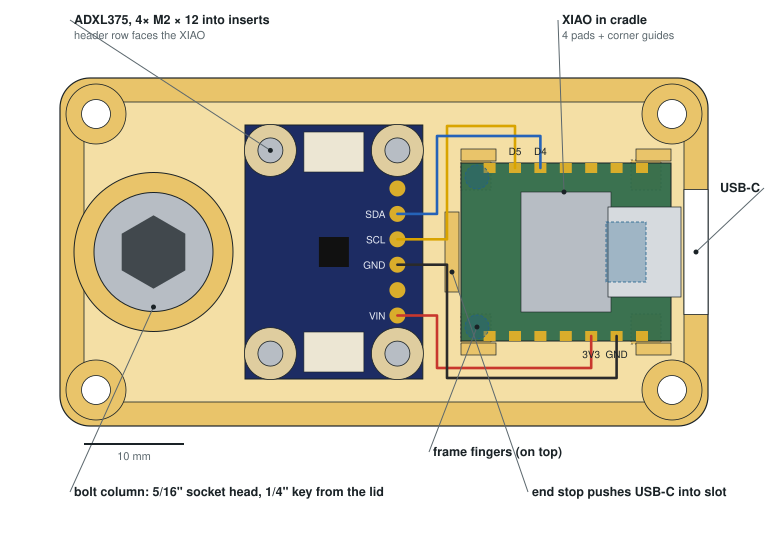
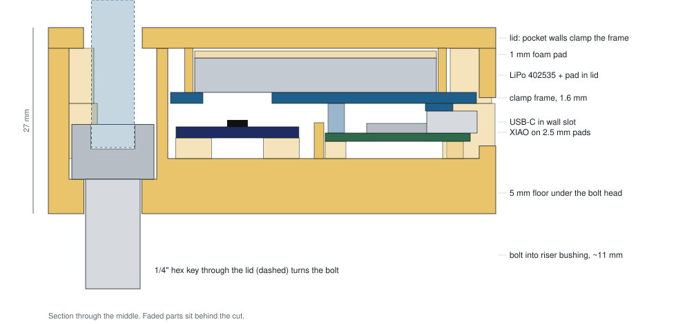
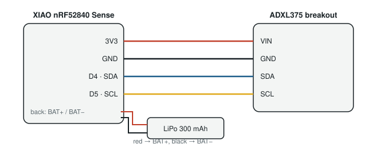

# PfeilZaehler3000 – Build and User Guide

Automatic arrow counter for recurve, barebow and compound bows.
Release 2.3.2

| Part | Version |
|---|---|
| Pod firmware | 2.3.2 (`firmware/PfeilZaehler3000`) |
| Debug firmware | 2.3.2-debug (`firmware/PfeilZaehler3000Debug`) |
| Phone page | 2.3.2 (`app/index.html`), English, German, Polish |
| Report page | 2.3 (`app/report.html`), English, German, Polish |
| Garmin watch app | 2.3.2 (`garmin/PfeilZaehler3000Watch`), English, German, Polish |
| Housing | v3 (`housing/`), washer since 2.3 |

## 1. What it is

PfeilZaehler3000 is a small sensor pod that is screwed into a stabilizer bushing of the bow. It
detects each shot from the vibration of the riser and stores the time of every arrow, together
with details of the shot: how long the raise, the draw and the hold took, how much the bow moved
while aiming, the bow angle and cant at the release and the follow-through. A web page on the
phone reads the pod over Bluetooth and shows arrows per end, session, day, week and month, and the
details of every arrow. An optional Garmin watch app shows the current end and vibrates on every
arrow.

The pod only measures the bow it is mounted on. Shots from other archers on the same target or
the same line are not counted. It does not record scores or arrow positions.

| | |
|---|---|
| Size | 65 × 35 × 27 mm |
| Weight | about 65 g including the bolt (measured; base printed with 100 % infill, steel bolt about 14 g) |
| Mount | 5/16"-24 UNF bolt into a stabilizer bushing |
| Battery | LiPo 3.7 V, 300–320 mAh, charged over USB-C |
| Memory | about 1,100 arrows with details between two syncs; when full, the oldest half makes room (counts are kept) |
| Connection | Bluetooth Low Energy, up to 3 devices at the same time |
| Bluetooth name | PfeilZaehler3000-XXXX (XXXX = last 4 characters of the pod's Bluetooth address) |
| Approx. cost | € 55–70 for all parts (2026 prices) |

World Archery rules do not allow electronic devices on the bow in competition. Remove the pod for
tournaments.

## 2. How a shot is detected

The pod contains two sensors: the gyroscope of the XIAO board and a high-g accelerometer
(ADXL375, ±200 g). An arrow is counted only when these three things happen in this order:

1. **Holding still.** The bow turns less than 25 °/s for 3 to 20 s (aiming). Shorter stillness
   happens while the bow is assembled or set down, longer stillness when the pod lies on a table.
2. **Release jolt.** The accelerometer sees a peak above 12 g when the string stops, reaching at
   least 25 g (real releases: about 29 g and more; weaker jolts are bumps).
3. **Ringing.** The riser keeps vibrating above 2 g for at least 6 samples within 10–150 ms after
   the peak.

After a counted shot, the pod ignores further jolts for 1.5 s. Putting the bow on a stand, bumping
it or carrying it does not produce this sequence. All thresholds can be changed in the firmware
(see section 11).

**Power saving.** After 3 minutes without movement the pod switches the sensors to a low-power
mode and only checks for movement 4 times per second. Picking up the bow wakes it. Bluetooth stays
available while it is idle, so the phone and the watch can connect at any time.

**Shot details.** The pod keeps the bow angle and rotation of the last 30 seconds in memory. At
every release it looks back and works out the phases of the shot:

| Detail | How it is measured |
|---|---|
| Raise | From the moment the lowered bow (pre-draw, at least 15° below or above the aiming angle) starts to move, until it is within 4° of the aiming angle |
| Draw & set | From reaching the aiming angle until the final hold starts |
| Hold | The bow turns less than 8 °/s until the release |
| Aim movement | How much the bow moves during the last second before the release (drift removed), in degrees; the phone page converts it to cm at the shooting distance |
| Bow angle | Angle of the arrow axis at the release (+ = aiming up) |
| Cant | Sideways tilt of the bow at the release (+ = top limb to the right), relative to the zero set on the phone page |
| Follow-through | How far the bow tips forward/down and sideways in the first 0.5 s after the release |
| Bow push | How far the bow moves down and sideways in the first 0.1 s after the release, in mm (needs all three calibration steps) |

Bow angle and cant are stored in 0.1° steps. The pod sees how the bow turns, not the drawing hand:
with a barebow the bow is often already still during the last part of the draw, so draw and hold
trade off against each other. Their sum, the **time at aiming height**, is reliable and is the main
figure on the phone page.

The thresholds are first estimates and can be adjusted (section 11). Raise and draw are only found
when the bow was lowered before the shot. Bow angle, cant and follow-through need the pod on the
back or the front of the riser, and the mounting point set (section 3); the bow push also needs the
third calibration step.

**Ends and sessions.** The phone page groups arrows into ends and sessions by the pauses between
them: by default a pause longer than 100 s starts a new end, and a pause longer than 45 minutes
starts a new session. "New end" on the phone or DOWN on the watch also starts a new end. Arrows per
end and the end pause are stored in the pod, so the phone page and the watch use the same values.

## 3. Bow compatibility

The pod is fastened with a **5/16"-24 UNF** bolt, the standard thread of stabilizer and weight
bushings on target bows. It fits any riser with a free bushing of this thread, for example the
lowest bushing on the back of the **Kinetic Sovren** barebow riser (the side facing the archer,
below the grip), and equally the stabilizer, V-bar or weight bushings of other recurve, barebow
and compound risers.

Check before building:

- **Thread.** The bushing must be 5/16"-24 UNF. Metric bushings (for example M6 or M8) need a
  different bolt and a different hole in the bolt column.
- **Depth.** About 11 mm of the 5/8" (16 mm) bolt sticks out of the pod. If the bolt bottoms out
  before the pod sits tight, use a 1/2" (12.7 mm) bolt.
- **Space.** The bolt is at one end of the pod, so the pod reaches about 50 mm to one side of the
  bushing. It must not touch the limbs, the arrow rest, the plunger or the string.
- **Flat seat.** The pod sits on the flat face around the bushing. Its underside has ribs that keep
  it from turning once the bolt is tight.

**Mounting point.** The pod knows three mounting points. Set it on the phone page or the watch,
or let the calibration find it (section 9, *Calibration*):

| Mounting point | Example | Measured |
|---|---|---|
| Back of the riser (archer's side) | Lowest bushing on the back of a Kinetic Sovren, as in the picture | Everything: arrows, phase times, aim movement, bow angle, cant, follow-through |
| Front of the riser (target side) | Long-rod (front stabilizer) bushing | Everything, as on the back |
| Side bushing | V-bar or a weight bushing on the side of the riser | Arrows, phase times and aim movement; no bow angle, cant or follow-through |

On the back and the front the bolt points towards the target or the archer, roughly along the
arrow, which the angle measurements need. The bushing does not have to be exactly level: on the
Sovren in the picture it sits on the curved lower part of the riser and is tilted by some degrees.
The calibration measures this tilt, and also sets the cant zero, so neither the tilt nor how far
the pod is turned around the bolt matters.
The extra 65 g changes the balance of the bow, so other weights may need adjusting.

## 4. Parts and tools

| Qty | Part | Notes |
|---|---|---|
| 1 | Seeed Studio XIAO nRF52840 **Sense** | Must be the "Sense" version (built-in gyroscope). Bluetooth, battery charger and USB-C on board. |
| 1 | Adafruit ADXL375 breakout (STEMMA QT, ±200 g) | High-g accelerometer. Normal ±16 g sensors clip at the release jolt. |
| 1 | LiPo cell 3.7 V, 300–320 mAh, size 402535 (4 × 25 × 35 mm), with protection circuit | Fits the pocket in the lid. A 502535 also fits without the foam pad. |
| 4 | Silicone wire AWG 28–30, about 6 cm each (red, black, yellow, blue) | Sensor to XIAO. The STEMMA QT plugs do not fit in the closed pod. |
| 1 | 5/16"-24 UNF socket head cap screw, 5/8" (16 mm), steel or A2 stainless (DE: Zylinderschraube mit Innensechskant 5/16-24 UNF × 5/8) | Mounting bolt. Turns freely in the pod. |
| 8 | M2 brass heat-set inserts, 4 mm long, 3.2 mm outside diameter | 4 for the sensor, 4 for the lid. |
| 8 | M2 × 12 mm countersunk screws (DIN 965 / ISO 7046) | 4 hold the sensor, 4 hold the lid. |
| 1 | 1 mm foam sheet (EVA or neoprene), 35 × 25 mm | Pad on the battery. |
| — | Heat-shrink tubing, thread locker (Loctite 243, optional) | |
| ~35 g | PETG-CF and plain PETG filament | Base and lid in PETG-CF, clamp frame in plain PETG. |
| 1 | STEMMA QT to jumper-wire cable (optional) | Only for the bench test before soldering. |
| 1 | Washer, printed in TPU or rubber (EPDM / neoprene) 8.4 × 18 × 1 mm (M8), optional but recommended | Between pod and riser: stops the pod from turning. |

Optional vibration motor (a buzz on every counted arrow): 10 mm coin vibration motor 3 V,
NPN transistor (2N2222 or S8050), 1 kΩ resistor, 1N4148 diode.

**Tools:** 3D printer with a hardened nozzle (for PETG-CF), soldering iron with a fine tip, side
cutters, 1/4" hex key with a long arm (at least 30 mm), USB-C data cable, a computer with the
Arduino IDE, and a phone with Chrome (Android) or the Bluefy browser (iPhone).

## 5. Print the housing

| File | Material | Infill | Orientation |
|---|---|---|---|
| `PfeilZaehler3000-base.stl` | PETG-CF | 100 % rectilinear | open side up |
| `PfeilZaehler3000-frame.stl` | PETG (no carbon fibre) | 40 % gyroid | fingers up |
| `PfeilZaehler3000-lid.stl` or `PfeilZaehler3000-lid-2color.3mf` | PETG-CF | 40 % gyroid | top face down |
| `PfeilZaehler3000-washer.stl` (optional) | TPU 95A | 100 % | flat |

- 0.2 mm layers, 4 walls, no supports.
- **Base with 100 % infill.** With a lower infill, the change to solid layers inside the 8 mm floor
  leaves a visible line on the outside wall at about 7 mm.
- **Frame in plain PETG**, so its fingers stay slightly springy. Carbon-filled PETG is too stiff and
  brittle for them.
- **Lid.** `PfeilZaehler3000-lid.stl` has the logo and "PFEILZÄHLER 3000" engraved 0.6 mm deep.
  For a two-colour lid (e.g. Bambu Lab with AMS), open `PfeilZaehler3000-lid-2color.3mf`, split the
  object into parts and put the small parts on the second filament. The text looks mirrored in the
  slicer because the lid prints face down.
- The insert holes are 2.9 mm. `PfeilZaehler3000-insert-test.stl` (in the repository) has holes
  from 2.7 to 3.0 mm for checking other inserts.
- `pod.scad` (OpenSCAD) is the source of all parts. Sizes such as the insert holes or the USB-C slot
  can be changed there.

## 6. How the parts fit together

No tape or glue is used inside the pod.

- **Base:** bolt column at one end, 4 bosses with inserts for the sensor, inserts in the 4 corner
  posts for the lid, and a cradle for the XIAO with 4 support pads, corner guides and an end stop.
- **ADXL375:** screwed onto the bosses next to the bolt column, so the release jolt reaches it
  without damping.
- **XIAO:** lies on 2.5 mm pads with its USB-C socket in the wall slot. The battery wires run
  underneath.
- **Clamp frame:** sits on the shoulders of the corner posts. Two fingers press on the XIAO's corners
  and a third on its USB-C socket.
- **Battery and foam pad:** lie on the frame inside the pocket of the lid.
- **Lid:** the walls of the battery pocket press the frame down when the 4 lid screws are tightened.
  A hole above the bolt column lets the hex key through.

## 7. Wiring

| From | To | Wire |
|---|---|---|
| ADXL375 VIN (header pin 1) | XIAO 3V3 | red |
| ADXL375 GND (pin 3) | XIAO GND | black |
| ADXL375 SCL (pin 4) | XIAO D5 | yellow |
| ADXL375 SDA (pin 5) | XIAO D4 | blue |
| LiPo red | XIAO BAT+ pad (back of the board) | check polarity twice |
| LiPo black | XIAO BAT− pad | |
| Motor (optional) | 3V3 → motor → transistor collector; emitter → GND; D2 → 1 kΩ → base | diode across the motor, stripe to 3V3; set `USE_MOTOR 1` |

## 8. Build steps

### 8.1 Inserts and bolt

1. Set the soldering iron to about 230–240 °C. Put each insert straight on its hole and let it sink
   in with light pressure until it is flush. First the 4 sensor bosses, then the 4 corner posts.
   Keep the iron vertical.
2. Drop the bolt into the bolt column from the top, thread first. It must turn freely. About 11 mm
   of thread sticks out of the bottom.
3. Test-fit the empty base on the bow (see section 3).

### 8.2 Arduino IDE

1. Install the Arduino IDE 2.
2. In **File → Preferences → Additional boards manager URLs** add
   `https://files.seeedstudio.com/arduino/package_seeeduino_boards_index.json`
3. In the Boards Manager install **Seeed nRF52 Boards**. Do not use the package called
   "Seeed nRF52 mbed-enabled Boards".
4. Select the board **Seeed XIAO nRF52840 Sense**. No additional libraries are needed.

### 8.3 Flash and bench test

1. Connect the ADXL375 to the XIAO with the STEMMA QT cable or 4 jumper wires (no soldering yet) and
   connect the XIAO to the computer.
2. Open `firmware/PfeilZaehler3000/PfeilZaehler3000.ino` and click **Upload**. If the upload fails,
   double-tap the reset button on the XIAO and upload again.
3. A long green flash means both sensors were found. Repeating red blinks mean a sensor is missing
   (see section 13).
4. Open the **Serial Monitor** at 115200 baud. Hold the board still for a second, then tap it
   sharply with a screwdriver handle. The monitor shows `jolt peak=… aim=… ring=… -> SHOT` or
   `-> ignored`. A light tap on the table is usually ignored, which is correct. After a counted
   shot a `details:` line follows (raise, draw, hold, aim movement, angle, cant, follow-through);
   on the bench most of these values are meaningless.
5. Leave the board untouched for 3 minutes. The monitor shows `-> idle`, and `-> active` when it
   is moved again. Both lines include the pod's name, e.g. `-> idle (PfeilZaehler3000-A3F2)`.
6. **Write the 4 characters of the name on the pod** (marker or label), e.g. *A3F2*. They come from
   the chip and never change. They tell this pod apart from other pods at the same range.

### 8.4 Assembly

1. Screw the ADXL375 onto its bosses with 4 M2 × 12 mm screws, component side up, with the header
   row facing the XIAO. Tighten until snug. The board must not rock, and it must not be bent.
2. Solder the 4 wires into the ADXL375 header holes (VIN, GND, SCL, SDA). Keep the joints flat.
3. Solder the battery to the BAT+ and BAT− pads on the back of the XIAO and cover the joints with
   heat-shrink.
4. Put the XIAO into its cradle, USB-C first into the wall slot, with the battery wires underneath.
5. Route the sensor wires between the corner guides and solder them to 3V3, GND, D4 and D5. Cut them
   short enough that they stay below the height of the frame.
6. Place the clamp frame, fingers down, onto the post shoulders. Lead the battery wires through the
   side opening.
7. Put the battery on the frame and the foam pad on the battery. Fit the lid so the battery sits in
   its pocket, then tighten the 4 lid screws evenly.
8. Shake the pod. Nothing may rattle. Charge it over USB-C (about 3–4 hours from empty, at 100 mA).

Never pinch or puncture the LiPo cell. If the lid does not close without force, a wire is lying
under the battery.

### 8.5 Mounting on the bow

1. Put the washer on the bolt between the pod and the riser (recommended): it grips both, so the
   release jolts can't turn the pod on its bolt.
2. Hold the pod against the bushing and start the bolt by hand with the hex key through the lid.
3. Align the pod, hold it in place and tighten the bolt firmly. The pod must not move. A drop of
   medium thread locker (Loctite 243, removable) on the bolt keeps it from loosening.
4. Draw the bow slowly and check that nothing touches the pod: string, arrow, fletching, bow hand,
   arm guard or sling. If anything comes close, use another bushing.
5. Check that the pod is tight before every session.
6. After mounting with the washer, shoot a few arrows and look at `peak_g` in the CSV: it should
   stay well above 25 g (real releases are about 29 g and more). A soft washer could damp the jolt.
7. To remove the pod, loosen the bolt through the lid. The pod does not need to be opened.

## 9. Phone page

The phone page is a single file, `app/index.html`, that runs entirely in the phone's browser. It
only contains the program: each phone connects to its own pod over Bluetooth and stores its history
in its own browser. Nothing is sent to the web server or to anyone else, so many people can use the
same web address without seeing each other's data.

Web Bluetooth only works on pages loaded over https, so the page is opened from a web address:

- **Published page:** the address in the README of this repository can be used by everyone.
- **Own copy:** fork the repository on GitHub and switch on Pages for the fork (Settings → Pages →
  Deploy from branch → `main`, folder `/ (root)`). The page is then at
  `https://<user>.github.io/<repository>/app/`. Alternatively drag the `app` folder onto
  app.netlify.com/drop.

**Language:** the page follows the phone's language (English, German or Polish); *Settings →
Language* changes it.

**Trying it without a pod:** adding `?demo` to the address (e.g. `…/app/?demo`) opens the page with
six weeks of example arrows, so every function can be tried without hardware. Nothing is saved, and
the real history is not touched; *Back to my data* returns to the normal page.

The history belongs to the exact web address. To move to another address, make a **Backup** on the
old page and **Restore** it on the new one.

Supported browsers: Chrome or Edge on Android, Windows, macOS, Linux and ChromeOS; on iPhone and iPad
the **Bluefy** browser (Safari and the other iOS browsers have no Web Bluetooth). Add the page to the
home screen for quick access. If Bluefy asks for "Paste" permission at every start, set
**Settings → Apps → Bluefy → Paste from Other Apps → Deny**.

All data is stored in the browser (local storage of that web address). Use **Backup** regularly.

### Functions

**Connection**

- **Connect pod & sync** – first connection: choose your pod (*PfeilZaehler3000-XXXX*) in the list.
  The page remembers it from then on, sets the pod's clock and time zone and downloads all new
  arrows.
- **Update now** – while connected: downloads new arrows and reads the battery voltage again.
- **Reconnect & update** – when the connection was lost.
- **Choose pod** – pick a different pod (the page then remembers that one).
- **Disconnect** – ends the connection.
- While connected, the page updates by itself after every arrow. When the page is opened again, it
  reconnects automatically, only to the remembered pod.

**Finding your pod:** every pod has its own name, e.g. *PfeilZaehler3000-A3F2* (see 8.3). Connect
for the first time with only your own pod nearby. If several pods are listed, choose one and look
for the blue LED: it lights on the pod that is connected.

**Status line** (on a computer, pointing at a symbol shows a short explanation):

| Symbol | Shows |
|---|---|
| Bluetooth | The pod's name, e.g. *Pod A3F2*: green when connected, amber while connecting, red while reconnecting, grey when not connected |
| Battery | Pod battery voltage; amber below 3.7 V, red below 3.6 V |
| Memory | How full the pod's memory is; it is cleared after a sync once it is fuller than the set value |
| Circular arrows | Time of the last sync |

Below the symbols a short message appears after a sync (e.g. *3 new arrows synced*) or when
something went wrong.

**This end:** arrows in the current end out of the set number per end (green when complete,
orange when more). **New end** starts a new end immediately, without confirmation. The pod and
the watch start a new end too.

**Totals:** arrows today, this week (from Monday), this month and all time.

**History:** bar chart of arrows per day (30 days), per week (12 weeks) or per month (12 months).

**Sessions:** the last 40 sessions with date, time span, number of ends and arrows, and the
average hold time, aim movement and cant spread. Ends with a different number of arrows than set
are highlighted. **Tap an end** to see its arrows and the averages of that end. Each arrow shows
the time of the first arrow (hours:minutes), then the time since the previous arrow
(+minutes:seconds), and its time at aiming height. Scored ends show their score.

- **Tap an arrow** to open its details: raise, time at aiming height (draw & set and hold), aim
  movement (degrees and cm), bow angle, cant, follow-through, bow push and jolt strength. With the pod in a side bushing, bow angle,
  cant and follow-through show "–".
- **Red bin:** delete a single arrow, e.g. a bump that was counted. The arrow is greyed out and
  can be restored with the green arrow.
- **Delete end**, with **Undo** in the status line.
- Deleted arrows are removed from all statistics and are also deleted on the pod and on the watch.

**Scores:** in the window of an end, tap the value of each arrow (X, 10 … 1, M) in any order; tap
an entered value to remove it. The score is saved when the end is complete, is sent to the pod with
the next connection and reaches the watch from there; a score entered on the watch shows up here.
Sessions show the total and the average per arrow. After a sync the page mentions ends that have no
score yet.

**Settings**

| Setting | Default | Effect |
|---|---|---|
| Language | Automatic | English, German or Polish; Automatic follows the phone |
| Arrows per end | 6 | Target for the end display and highlighting; stored in the pod, shared with the watch |
| New end after a pause of (s) | 100 | Pause that separates ends; stored in the pod, shared with the watch |
| New session after a pause of (min) | 45 | Pause that separates sessions |
| Shooting distance for the aim movement (m) | 18 | Converts the aim movement from degrees to cm on the target |
| Clear pod memory after sync when fuller than (%) | 50 | Frees the pod's memory once the arrows are safely on the phone |
| Target face | Full face | Full face or 3-spot: on a 3-spot only X, 10–6 and M are offered for scoring; stored in the pod, shared with the watch |
| Pod mounted on | back of the riser | Back, front or side bushing (section 3); stored in the pod, shared with the watch, set by the calibration |
| Calibrate… | – | See below |

Changes to arrows per end and the end pause only apply from the moment they are changed; earlier
ends keep their grouping. A change on the watch shows up here, and the other way round; the last
change counts.

**Calibration** (once after mounting the pod and after updating from a version before 2.2, about 15 seconds; the pod
must be connected):

1. Hold the bow upright as when aiming, without cant and with the arrow level (horizontal), and
   keep it still; a bubble level helps. Tap **Next**. This position becomes cant 0 and bow angle 0,
   which also removes the tilt of the bushing.
2. Point the arrow at the ground, about 45° down, keep the bow upright and still. Tap **Next**.
   From the way the pod turned, it finds its mounting point (back, front or side) and stores it.
3. Tilt the bow far to the side, at least 45° as if laying it down, and keep it still. Tap
   **Finish**. From this the pod works out how its two accelerometers sit, which the bow push needs.
   If the bow was not tilted far enough, everything else is calibrated and only the bow push is not
   measured; repeat the calibration to get it.

You can hold the bow in one hand and tap the phone with the other: after each tap the pod waits
until the bow has been still for a second (at most 4 s) and only then measures, so the tap itself
doesn't count (pod firmware 2.3.2). If the bow doesn't get still in time, the page says so and the
same step is simply repeated; the earlier calibration stays as it was.

The settings show the result, e.g. *Calibrated, pod on the back of the riser*. If the bow
was not tilted far enough, the calibration asks to start again. Until it is calibrated, the first
shot counts as cant 0.

**Export & backup**

- **Export CSV** – one line per arrow: index, local date and time, unix time, jolt (g), still time
  before the release (s), raise, draw and hold (s), aim movement, bow angle and cant (°),
  follow-through down and right (°), bow push down and right (mm), clock exact (1/0), deleted (1/0),
  start of the end, end score and the values of the end. On iPhone it opens the share sheet.
- **Report** – opens the report page (below).
- **Backup** – the complete history as a JSON file.
- **Restore** – reads a backup from a file or from pasted text and merges it with the existing data,
  including the end scores.

**Report page** (`app/report.html`, **Report** under Export & backup). It reads the arrows the phone
page keeps in the same browser, so nothing needs to be exported; **Open backup…** shows the data
of a backup file instead (another phone, a laptop, someone else's data). Everything is worked out
in the page, without the pod and without internet.

- **Day:** cant per arrow, aim movement per end, hold and aim movement by arrow in the end, time at
  aiming height, follow-through, bow push and scores per end, with a table of the arrows. Ends
  separated by a break of 10 minutes or more form blocks.
- **Week, Month:** one point per day: arrows and false counts, time at aiming height, aim movement,
  cant spread within the ends, follow-through, stillness before the release and score per arrow;
  the arrow-in-the-end effect over the whole period.
- **All time:** the same with one point per week.
- **From:** leaves out everything before this date (remembered in the browser); by default the
  first day with shot details. Arrows shot before a calibration (cant beyond ±30°) are left out of
  the cant charts.
- Short **notes** beside the charts state what the data shows, e.g. a cant that drifts the same way
  in most ends (the pod turning on its bolt), aim movement rising during a block, or later arrows
  of an end held shorter.
- Pointing at or tapping a mark shows its values. **Save report** creates one HTML file with the
  shown data from *From* on, to pass on (e.g. to a coach); it opens in any browser.

**Reset** (both ask for confirmation)

- **Reset today** – deletes today's arrows on the phone, the pod and the watch.
- **Reset all stats** – deletes the whole history on this phone and, if the pod is connected, clears
  the pod's memory and its day counters. Make a backup first.

## 10. Garmin watch app

The watch app has been built for the **Garmin Epix (Gen 2)**. It connects to the pod directly; the
phone is not needed while shooting. Other Garmin watches with Connect IQ 3.2 or newer and Bluetooth
Low Energy support may work after adding them in `manifest.xml`; this has not been tested.

### Screen

From top to bottom:

- Time of day.
- The pod's ID and battery voltage, e.g. *Pod A3F2 3.95 V* (orange when getting low, red when it
  needs charging), or the connection state: *Looking for Pod A3F2…*, *Pod A3F2 in range?*,
  *Connecting…*, *Reconnecting…*. From 80 % pod memory: *Pod 85% full: sync phone* (sync with
  the phone page soon; when the memory is full, the pod drops its oldest records).
- End number and time since the last arrow.
- The big number: arrows in the current end (green when complete, orange with an extra arrow), or
  the session or today's arrows, as chosen in the settings.
- The other counters in a row: this end (e.g. *4/6*), session, today and week, without the one
  shown big. Today, week and month come from the pod and match the phone page, including arrows
  shot while the watch app was closed.
- Arrows this month.
- Recording time, or *START: record*.
- Time to sunset, if switched on.

### Buttons

| Button | Function |
|---|---|
| START | Start / stop recording a Garmin activity "Bogenschiessen" |
| BACK | Saves a running activity; pressed again, leaves the app |
| DOWN | Start a new end now (also shown on the phone page) |
| UP | Delete the last arrow, after a confirmation (also deleted on the phone page); only while the pod is connected |
| hold UP | Settings |
| hold the screen | Scoring screen for the current (or the last) end |

Otherwise the touchscreen is only used on the scoring screen, so a touch can't start a recording or
change anything.

### Scoring

The scoring screen opens by itself 3 s after the last arrow of an end, and also when the bow is
put on the stand with the end complete (if it was not open yet). With *Scoring: By hand only* it
opens only by holding the screen, or with *Score last end* in the settings. Enter the value of every arrow in any order, then confirm; tapping an entered value
removes it. The buttons work too: UP/DOWN choose a value, START enters it, BACK removes the last
one or leaves.

| Design | Entry |
|---|---|
| Numpad (default) | X 10 9 8 / 7 6 5 4 / 3 2 1 M (3-spot face: X 10 9 8 7 6 M) |
| Dial | the values around the edge of the screen like a clock face |
| PiMalDaumen | tap where the arrow hit on a drawn face; the inner rings are drawn wider so they can be hit with a finger. The hits are saved with the score |

After saving, a summary shows the end, the session total and the average per arrow, and how this
end compares with the session so far. The score is sent to the pod and reaches the phone page with
its next sync; a score entered on the phone shows up on the watch.

### Settings (hold UP)

| Setting | Values | Stored |
|---|---|---|
| Arrows per end | 3–12 (default 6) | in the pod, shared with the phone page |
| New end after | 30 s – 5 min (default 100 s) | in the pod, shared with the phone page |
| Big number | this end, session or today | on the watch |
| Time to sunset | on / off | on the watch; uses the weather position from Garmin Connect or the last GPS position |
| Scoring | opens by itself, by hand only, off | on the watch |
| Score design | numpad, dial, PiMalDaumen (an example is shown after choosing) | on the watch |
| Target face | full face, 3-spot | in the pod, shared with the phone page |
| Score last end | opens the scoring screen | – |
| Mounting point | back of riser, front of riser, side bushing | in the pod, shared with the phone page |
| Language | Automatic (as the watch), English, Deutsch, Polski | on the watch |
| Use a different pod | after a confirmation, connects to the next pod found | on the watch |
| Version | the watch app's version and the pod's firmware | – |

- **Vibration:** short on every arrow, double when the end is complete.
- **Ends:** a pause longer than the set time, or DOWN, starts a new end.
- **Recording:** a recorded activity contains duration, heart rate and calories like any other
  activity, plus the number of arrows and ends in the summary, a chart of the arrow count and one
  lap per end with its number of arrows and, if scored, its score; the session score and the
  average per arrow are in the summary. Garmin's own Archery activity cannot be used by Connect IQ
  apps, so the recording is saved as a generic activity; its type can be changed afterwards in
  Garmin Connect.
- **Reconnecting:** if the pod is out of range, the watch reconnects by itself when it is back.
- **Own pod:** the watch remembers the first pod it connects to and from then on only connects to
  that one, even when other pods are nearby. Open the app for the first time with only your own pod
  nearby. Use *Use a different pod* in the settings to change it.
- **Deleted on the phone:** an arrow deleted on the phone page is also taken off the watch's
  session and end; a restored one comes back without a vibration.

### Build and install

1. Install **Java** (JDK 17 or newer, e.g. Temurin from adoptium.net). Check with
   `/usr/libexec/java_home -V` on a Mac.
2. Install the **Connect IQ SDK Manager** (developer.garmin.com/connect-iq/sdk), sign in, download
   the newest SDK and set it as active. Under *Devices* download **epix (Gen 2)** (listed under API
   level 5.2).
3. Install **Visual Studio Code** and the extension **Monkey C** (Garmin).
4. In VS Code: *Monkey C: Verify Installation*, then *Monkey C: Generate a Developer Key*. Keep the
   key private and safe; updates of the app must be built with the same key.
5. Open the folder `garmin/PfeilZaehler3000Watch` and run *Monkey C: Build for Device* → **epix2**.
   The result is a `.prg` file.
6. Copy the `.prg` file to `GARMIN/APPS` on the watch. On a Mac this needs an MTP tool such as
   **OpenMTP**; quit Garmin Express first. If the watch's folders do not show, switch OpenMTP between
   its legacy and Kalam mode.
7. Unplug the watch. Press START, scroll to the end of the activity list, choose **Add** and add
   **PfeilZaehler3000**.

## 11. Calibration and tuning

1. Shoot 3–4 normal ends and sync. Check whether every end shows the right number of arrows.
2. Use **Export CSV** and look at the `peak_g` column: it shows how hard the releases hit the riser.
   Light draw weights give smaller values.
3. **Arrows missing:** set `SPIKE_G` to about half of the lowest `peak_g` and upload the firmware
   again.
4. **Extra arrows:** raise `MIN_AIM_MS` or `MIN_PEAK_G`. Arrows missing with a light bow: lower
   `MIN_PEAK_G` to about 80 % of the lowest `peak_g`.

**Shot phases.** Upload the debug firmware (section 14), open the Serial Monitor and shoot a few
arrows. After every shot it prints the details and a trace of the last 12 s (bow angle / rotation,
5 values per second). If raise, draw or hold look wrong, adjust `HOLD_DPS`, `AWAY_DEG` or
`LEVEL_DEG`. Sending a few of these traces makes tuning easier.

The values are at the top of the firmware file:

| Name | Default | Meaning |
|---|---|---|
| `SPIKE_G` | 12 | Release jolt threshold (g) |
| `RING_G` | 2 | Ringing level (g) |
| `RING_MIN_SAMPLES` | 6 | Ringing samples needed 10–150 ms after the jolt |
| `STILL_DPS` | 25 | Rotation below this counts as holding still (°/s) |
| `MIN_AIM_MS` | 3000 | Minimum holding time before the release (ms) |
| `MAX_AIM_MS` | 20000 | Longer stillness is a pod lying still that got knocked, not a shot (ms) |
| `MIN_PEAK_G` | 25 | Weaker jolts are bumps (g) |
| `REFRACTORY_MS` | 1500 | Dead time after a counted shot (ms) |
| `IDLE_AFTER_MS` | 180000 | Time without movement before power saving (ms) |
| `HOLD_DPS` | 8 | Rotation below this counts as the final hold (°/s) |
| `AWAY_DEG` | 15 | Angle away from the aiming angle that counts as lowered (pre-draw) (°) |
| `LEVEL_DEG` | 4 | Angle within this of the aiming angle counts as raised (°) |
| `REST_DPS` | 5 | Rotation below this for 0.3 s while lowered counts as resting (°/s) |
| `FOLLOW_MS` | 500 | Time after the release for the follow-through (ms) |
| `CALIBRATION_LOG` | 1 | Print every jolt to the Serial Monitor |
| `USE_MOTOR` | 0 | 1 = vibration motor on D2 |

## 12. Daily use and charging

- Shoot as usual. A short green flash on the pod confirms a counted arrow.
- Open the phone page after training (or keep it connected). The watch app can run at the same
  time.
- Charge when the voltage is below about 3.6 V. The watch shows this in orange and red.
- Battery life depends on how long the pod is moved and awake. A pod lying unused switches to power
  saving after 3 minutes (shown as `-> idle` on the Serial Monitor).

**Pod LED**

| LED | Meaning |
|---|---|
| Green, 0.3 s after switching on | Both sensors found |
| Short green flash | Arrow counted and stored |
| Short red flash after a shot | Arrow could not be stored (flash error); sync and restart the pod |
| Red, 1 blink repeating | Gyroscope (XIAO) not found |
| Red, 2 blinks repeating | ADXL375 not found |
| Blue | Phone or watch connected |

## 13. Troubleshooting

| Problem | Solution |
|---|---|
| Upload fails, or no port appears | Double-tap reset (bootloader mode). Use a USB cable that carries data. |
| macOS: `exec: "python" not found` during upload | In Terminal: `sudo ln -sf "$(which python3)" /usr/local/bin/python` |
| macOS: error about ASCII / locale during upload | `launchctl setenv LANG en_US.UTF-8` and `launchctl setenv LC_ALL en_US.UTF-8`, then restart the Arduino IDE |
| Red, 1 blink repeating | Wrong board selected. Use "Seeed XIAO nRF52840 Sense" from the non-mbed package. |
| Red, 2 blinks repeating | Check the ADXL375 wiring: SDA to D4, SCL to D5, VIN to 3V3. |
| Pod hangs after the battery was soldered | Flash the debug firmware and read the Serial Monitor (section 14). |
| Ends often one arrow short | Lower `SPIKE_G`. Check that the sensor screws and the mounting bolt are tight. |
| Extra arrows | Raise `MIN_AIM_MS` or `SPIKE_G`. Putting the bow down hard can look like a shot. |
| The cant drifts the same way during the ends | The pod turns on its bolt: tighten it, and use the washer (8.5). |
| Battery empty after a few days | Check on the Serial Monitor that the pod shows `-> idle` after 3 minutes. The debug firmware never sleeps. |
| "No Web Bluetooth" on the phone page | Open it over https in Chrome or Edge, or in Bluefy on iPhone. |
| Arrows listed without a date | The pod restarted with an empty battery and had no clock. Connect the phone page after charging. |
| Phone page connects but doesn't update, or needs extra taps (e.g. in Bluefy) | Open the page with `?log` at the end of the address (…/app/?log), repeat what went wrong, open **Log** at the bottom, tap **Copy log** and send it along with a bug report. |
| Today / week / month off by a few arrows after travelling to another time zone | Arrows already cleared from the pod keep the day they were counted on in the old time zone; at most one evening's arrows can move to the neighbouring day. The phone page's own history is not affected. |
| Watch shows "Update pod firmware" | Flash the current pod firmware (2.3.2). |
| Watch stays at "Pod … in range?" | Check the distance to the pod and that the pod is charged. |
| Phone or watch connected to another archer's pod | Phone: **Choose pod** and pick your own name. Watch: hold UP → *Use a different pod*, confirm, and keep only your own pod nearby. |
| No raise / draw times | The bow was not lowered before the shot, or the history was empty after the pod woke up. Hold and the other details are still measured. |
| Cant values look offset | Calibrate again (phone settings → *Calibrate…*) with the bow exactly upright. |
| Bow angle negative when aiming up, cant or follow-through reversed | The mounting point is set wrong: calibrate, or set *Pod mounted on* in the settings (section 3). |
| Bow angle, cant and follow-through show "–" | The mounting point is set to *side bushing*. |
| Which name is my pod? | Connect and look for the blue LED, or read the name on the Serial Monitor (section 8.3). |

## 14. Debug firmware

`firmware/PfeilZaehler3000Debug` has the same functions and Bluetooth interface as firmware 2.3.2,
so the phone page and the watch work with it. In addition it:

- waits up to 5 s for the Serial Monitor and prints the reset reason,
- prints every start-up step including the pod's name and Bluetooth address, the state of both I2C
  buses and the I2C addresses found,
- prints a status line every 2 s: sensors, awake/idle, Bluetooth connections and advertising,
  records, arrows today/week/month, battery voltage, the current accelerometer values, the bow
  angle and the rotation,
- prints the shot details and a 12 s trace of bow angle and rotation after every arrow,
- blinks the blue LED briefly every 2 s while nothing is connected,
- never switches to power saving, so it empties the battery within a few days.

Use it for diagnosis only, then upload the normal firmware again.

## 15. Files

| Path | Content |
|---|---|
| `firmware/PfeilZaehler3000/` | Pod firmware 2.3.2 (Arduino) |
| `firmware/PfeilZaehler3000Debug/` | Debug firmware |
| `app/index.html` | Phone page 2.3.2 |
| `app/report.html` | Report page 2.3 |
| `garmin/PfeilZaehler3000Watch/` | Garmin watch app 2.3.2 (Connect IQ project) |
| `housing/` | STL and 3MF files (incl. the TPU washer), OpenSCAD source `pod.scad`, insert test |
| `docs/` | This guide, Bluetooth protocol, images |

## 16. Safety, data and licence

### On the bow
- Tighten the bolt firmly and check that the pod sits tight **before every session**. A loose pod
  can turn or fall off at the release. The optional washer (`housing/PfeilZaehler3000-washer.stl`,
  TPU, or an 8.4 × 18 × 1 mm rubber washer) stops it from turning on the riser.
- Before the first shot, draw the bow slowly and check that nothing touches the pod: string, arrow,
  fletching, your bow hand, arm guard or sling. Choose another bushing if anything comes close.
- Don't mount it in place of a stabilizer you need, and never point a drawn bow at anyone while
  checking the fit.
- The pod is not waterproof. Dry it after shooting in the rain; don't leave it in a hot car.

### Battery (LiPo)
- Use a cell with a protection circuit, and check the polarity twice before soldering.
- Charge only over the pod's USB-C port, at room temperature, and not unattended or overnight.
- A swollen, dented or hot battery is not used again: take it out and recycle it (battery
  collection point, not the household waste).
- Never short-circuit, puncture or squeeze the cell. Keep the pod away from small children.

### Building
- The soldering iron and the heat-set inserts get hotter than 200 °C. Work on a heat-proof mat,
  with fresh air, and wash your hands after soldering. Under 18: with an adult.
- Print the housing in PETG (or PETG-CF), not PLA, and the washer in TPU.

### Your data
- The phone page keeps everything in your phone's browser; nothing is sent to this repository or to
  anyone else. Make a backup now and then: clearing the browser data deletes the history.
- A backup or a saved report contains every arrow with its date and time, so it shows when and how
  often you train. Share it only with people you trust, e.g. your coach.
- When you post photos of it, check what's in the background (club, range, car plates) and turn off
  location tags.

### Rules and limits
- World Archery rules – and most national federations – do not allow electronic devices on the bow
  in competition. Check your federation's and your club's rules; this is a training tool.
- The pod can miss an arrow or count something that isn't one. Its counts and scores are not
  official.
- Questions and bug reports belong in public [GitHub issues](https://github.com/ckpt-gthb/pfeilzaehler3000/issues),
  not private messages. Security problems: see `SECURITY.md`.

This is a hobby project, provided as it is, without any warranty; you build and use it at your
own risk. Kinetic, Garmin, Epix, Seeed, Adafruit and Bluefy are trademarks of their respective
owners; this project is not affiliated with them.

### Licence

PfeilZaehler3000 is free for personal, non-commercial use. The software (firmware, phone page,
report page, watch app) is licensed under the **PolyForm Strict License 1.0.0**, with additional
permissions to change it for your own use and to give unchanged copies to others for their
non-commercial use; the housing models, drawings and this guide under **Creative Commons
Attribution-NonCommercial-NoDerivatives 4.0 (CC BY-NC-ND 4.0)**. Selling pods, kits, prints or apps
based on it needs a commercial licence from the licensor (ckpt-gthb). See `LICENSE`,
`LICENSE-hardware` and `CONTRIBUTING.md`.
