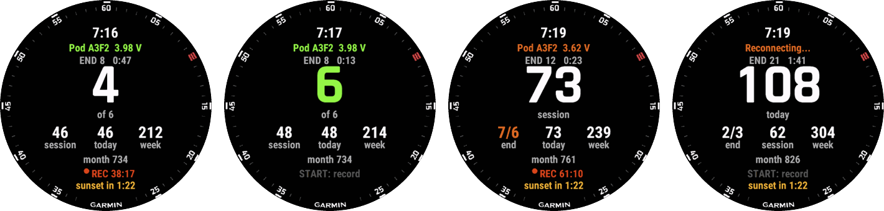
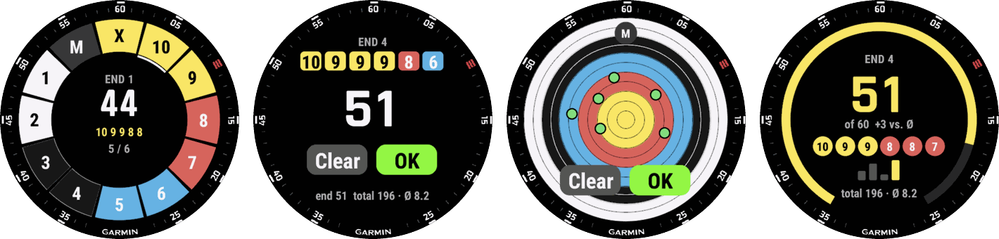
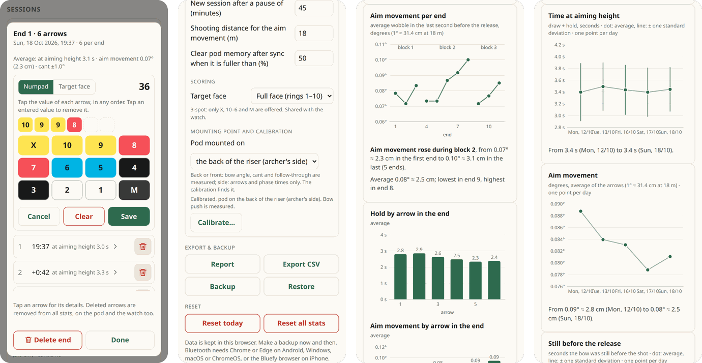

# Screenshots

Release 2.2. The phone page in light mode on a phone-sized screen, the watch app on a Garmin
Epix (Gen 2).

## Watch app

*Main screen: recording with the time to sunset · end complete (6 of 6 in green) · session as the
big number, an extra arrow and the pod battery getting low · today as the big number while the pod
is out of range.*

*Scoring an end: it opens 3 s after the last arrow, or with a long touch on the main screen ·
numpad · PiMalDaumen, tap where the arrow hit · summary with the end, the session total and the
average per arrow.*

*The dial design · a full end on the numpad, saved with OK · a full end on PiMalDaumen · the
summary, with a bar per end of the session.*

*Settings (hold UP): target face, score last end, mounting point, language · using a different
pod.*

## Phone page

*Status, current end and totals · sessions with their scores · the arrows of one end with its
score, one arrow's details opened · the report page (Day), scores per end first.*

*Entering a score (numpad, or tap where the arrows hit on the target face) · settings with the
target face and the calibration · report: aim movement per end and hold by arrow in the end, with
notes · report: one point per day in the Week tab.*
